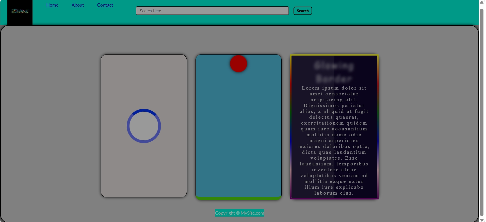

# 🏢 AppWars Technologies | Frontend Development Internship

> **Developer:** Ishani Jain ([@coderishani](https://github.com/coderishani))

## 📌 Internship Context
This repository contains the frontend web development deliverables completed during my professional internship at **AppWars Technologies**. 

The project was designed as a static UI sandbox to practice strict DOM structuring, responsive layouts, and experimental CSS keyframe animations (such as custom loaders and bouncing physics) without relying on JavaScript.

## 🧰 Tech Stack Utilized
* **Frontend Structure:** HTML5 (Semantic UI)
* **Design & Styling:** CSS3 (Flexbox, Grid, Media Queries, Keyframes)
* **Deployment:** GitHub Pages

---

## 💻 Visual Preview

**Live Demo:** [Click here to view the live project](https://coderishani.github.io/Ishani_Frontend/)

---

## 📂 Project Architecture
<pre>
Ishani_Frontend/
├── css/
│   ├── style.css
│   ├── responsive.css
│   └── utils.css
├── images/
│   ├── homepage.png
│   └── Ishani Name Logo.jpg
├── index.html
└── README.md
</pre>

## ✨ Key Responsibilities & Features
* **Pure CSS Architecture:** Built strictly without JavaScript to enforce a deep understanding of HTML semantics and CSS cascading rules.
* **Responsive UI Implementation:** Engineered modular stylesheets (`responsive.css`, `utils.css`) to ensure cross-browser compatibility and a mobile-first design approach.
* **CSS Keyframe Animations:** Integrated experimental visual components directly into the UI, including a custom loading spinner and dynamic shifting color gradients.

## 📈 Learning Outcomes & Professional Growth
* Transitioned from building basic static pages to understanding modular, production-level frontend styling architecture.
* Mastered native browser animations and layout debugging techniques.
* Utilized version control (Git/GitHub) and deployed static sites to a live production environment via GitHub Pages.

## 🚀 How to Run Locally
1. Clone the repository:
   <pre>git clone https://github.com/coderishani/Ishani_Frontend.git</pre>
2. Navigate into the directory and open `index.html` in any modern web browser.

---

## 👤 Author
**Ishani Jain**
* B.Tech Computer Science & Information Technology
* GitHub: [@coderishani](https://github.com/coderishani)

⭐ *If you found this repository helpful, consider giving it a star!*
